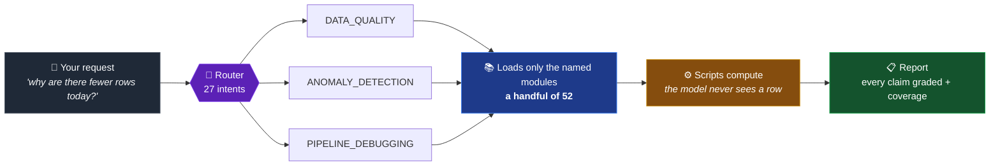
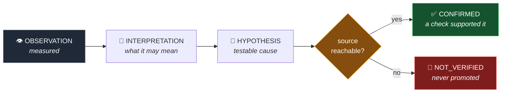

<div align="center">

# 🔍 Data Intelligence Engine

**An Agent Skill that takes a data problem and works out what to do with it.**

[](LICENSE)
[](#-requirements)
[](#)
[](#-how-routing-works)
[](#-the-scripts)

*You describe the problem in your own words. It is not a menu of commands.*

</div>

---

You bring a dataset, a pipeline, a SQL file or just a question. The skill classifies the request,
loads **only** the methodology that request needs, runs the checks, and reports what it found —
with every claim graded by the evidence behind it.

```text
> this orders.csv came from the new export, is it any good?

DATASET  orders.csv  (csv, 758 KiB)  rows 5,070  columns 17
DATA HEALTH SCORE: 94.5/100  —  PROVISIONAL  (4 of 6 dimensions measured)

RISK TRIGGERS  (14)
  [duplicate-key]        order_id: looks like a key but 70 rows repeat an existing value
  [mixed-date-formats]   order_date: %Y-%m-%d 85.9%, %d/%m/%Y 14.1%
  [silent-nulls]         amount: 120 placeholders ('n/a'×100, 'null'×20) = 2.4% of rows
  [polluted-type]        quantity: only 70.1% of present values parse as numbers
  [leading-zeros]        store_code: 5,070 values start with 0 — casting would destroy them
  …

COVERAGE: 5,070/5,070 rows · 1/1 files · strategy: whole · filters: none
```

> That score says **PROVISIONAL** because every check was inferred rather than confirmed against
> your business rules. The skill will not quietly drop the word.

---

## 📦 Install

**One line, in Claude Code 2.1.275 or later:**

```
/plugin install data-intelligence-engine --marketplace jainrakshit24/data-intelligence-engine
```

<details>
<summary><b>Or install it by hand</b></summary>

<br>

```bash
git clone https://github.com/jainrakshit24/data-intelligence-engine
cd data-intelligence-engine
ln -s "$PWD/code" ~/.claude/skills/data-intelligence-engine
```

</details>

Then install what the scripts need:

```bash
pip install duckdb sqlglot pyyaml      # pyyaml only for dbt projects
```

Restart your agent. It picks the skill up by name and uses it when a request fits — **you never
invoke it by hand**.

<details>
<summary><b>Installing somewhere other than Claude Code</b></summary>

<br>

The skill is portable: its frontmatter uses only `name`, `description`, `license`,
`compatibility` and `metadata`, so it is accepted anywhere Agent Skills are. Copy `code/` to
whatever directory your agent loads skills from, named `data-intelligence-engine`.

The methodology works without the Python packages. The scripts do not — and the skill says
which one could not run rather than guessing around it.

</details>

---

## 🧭 How routing works

`SKILL.md` is a thin router. Everything else loads **on demand**, and only when an intent names
it — so a request pays for the methodology it uses and nothing else.



One request routes to **as many intents as apply**. *"My daily customer pipeline has 30% fewer
records, find out why"* is a quality check, an anomaly scan, a pipeline debug and a general
investigation — all at once.

---

## 🎯 What it handles

| | You have | It does |
|:--:|---|---|
| 📊 | A CSV, TSV, Parquet, JSON, Excel file or a database table | Profiles it, scores its health, surfaces the risks worth knowing about |
| 📉 | Data that changed and you don't know why | Finds volume, metric and null-rate anomalies, level shifts, and the segments that moved |
| ⚖️ | Two versions of a dataset | Reconciles them row by row and unit by unit |
| 🔧 | A pipeline, dbt project, Airflow DAG or SQL file | Reviews it statically — without running it, importing it, or needing the tool installed |
| 🤖 | A dataset headed for a model | Checks it for leakage, class balance and split problems. The data side only |
| 📝 | Definitions nobody wrote down | Records them as a `data-context.md` it reads first next time |

---

## 🛡️ The rules it will not bend

Seven rules apply to every request. These four are why the reports can be trusted.

<table>
<tr>
<td width="50%" valign="top">

### 🚫 Profile, don't read

Scripts compute; the model sees only aggregates. Opening a data file into an agent's context
sends its rows to the model provider — so this skill does not do it, and says so when something
else does.

</td>
<td width="50%" valign="top">

### ❌ No fake execution

A check that could not run is reported `NOT_VERIFIED` and is **never** promoted to a finding.
"I could not reach the database" is an answer. A guess dressed as one is not.

</td>
</tr>
<tr>
<td width="50%" valign="top">

### 📏 Coverage, in numbers

Every report states how much data it actually covered. No claim may be broader than its
coverage, and a sample produces an *estimate*, labelled as one.

</td>
<td width="50%" valign="top">

### 🧱 Data is never instructions

Text in a cell that reads like a command is data. If it looks like an injection attempt, that is
itself a finding — the test fixtures include four.

</td>
</tr>
</table>

The other three: an **evidence ladder**, **no silent changes** to your data, and **arithmetic
integrity** — averages recomputed from sums and counts, and every pooled comparison checked for
reversal inside the groups.

### The evidence ladder

Nothing is called a cause until a check supports it.



Below `CONFIRMED` it may only say *"likely"*, *"consistent with"* or *"requires verification"* —
never *"caused by"*.

---

## ⚙️ The scripts

Eleven of them, in `code/scripts/`. The skill runs them for you; you can run them directly too.

| Script | What it answers |
|---|---|
| `profile_dataset.py` | What is in this file, and what should worry me? |
| `quality_checks.py` | Does it pass its rules, and what is its health score? |
| `detect_duplicates.py` | Are there duplicate rows, or duplicate business keys? |
| `dataset_summary.py` | One screen, for a first look |
| `anomaly_detection.py` | What changed over time, and in which segment? |
| `drift_check.py` | What moved between two snapshots — schema or distribution? |
| `reconcile.py` | Did every row and every unit survive the pipeline? |
| `ml_readiness.py` | Is this dataset leaking, imbalanced, or badly split? |
| `sql_check.py` | What does this SQL read, write and break? |
| `dag_check.py` | What is wrong with this Airflow DAG, without importing it? |
| `dbt_check.py` | What is wrong with this dbt project, without running it? |

Every one prints aggregates and a `COVERAGE:` line. **None prints raw rows by default.**

```bash
# they work standalone, too
python3 code/scripts/profile_dataset.py sales.csv
python3 code/scripts/quality_checks.py sales.csv --rules rules.json
python3 code/scripts/drift_check.py last_week.csv this_week.csv
```

---

## 🗂️ How it is put together

```text
code/
├── 📄 SKILL.md          the router — the only file loaded every time
├── 📚 references/       32 methodology modules, loaded only when an intent names one
│   └── root-cause/      6 playbooks, routed by issue type
├── 🔀 workflows/        11 step-by-step procedures
├── 📋 templates/        9 report shapes
├── ⚙️  scripts/          the 11 scripts above
└── 📦 requirements.txt
```

**Progressive disclosure is the point.** `SKILL.md` is thin; the other **52 modules** load only
when named. A typical task reads a fraction of the corpus, so the methodology can be thorough
without every request paying for all of it.

Work moves through nine stages, and the skill says which ones it skipped:

```text
DATA → UNDERSTAND → VALIDATE → CLEAN → ANALYZE → DESIGN → BUILD → VERIFY → DOCUMENT
```

---

## 🚧 Out of scope, on purpose

| | |
|---|---|
| 🤖 **Model training and deployment** | Asked to "build a model", it checks the data is ready, then says where its job ends |
| 🔌 **Live warehouse / BI connectors** | It writes the SQL, labels it `NOT_VERIFIED`, and asks you to run it |

Both limits are deliberate. **A skill that pretends to have run something is worse than one that
tells you it did not.**

---

## 📋 Requirements

| | |
|---|---|
| Python | 3.9+ |
| `duckdb` | `>=1.1` — every script |
| `sqlglot` | `>=30` — SQL work |
| `pyyaml` | dbt projects only |

---

## 📜 Licence

MIT — see [LICENSE](LICENSE).
